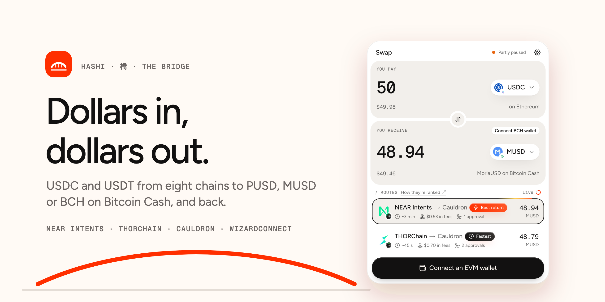
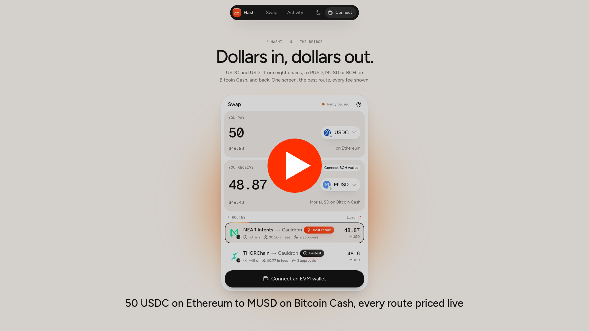
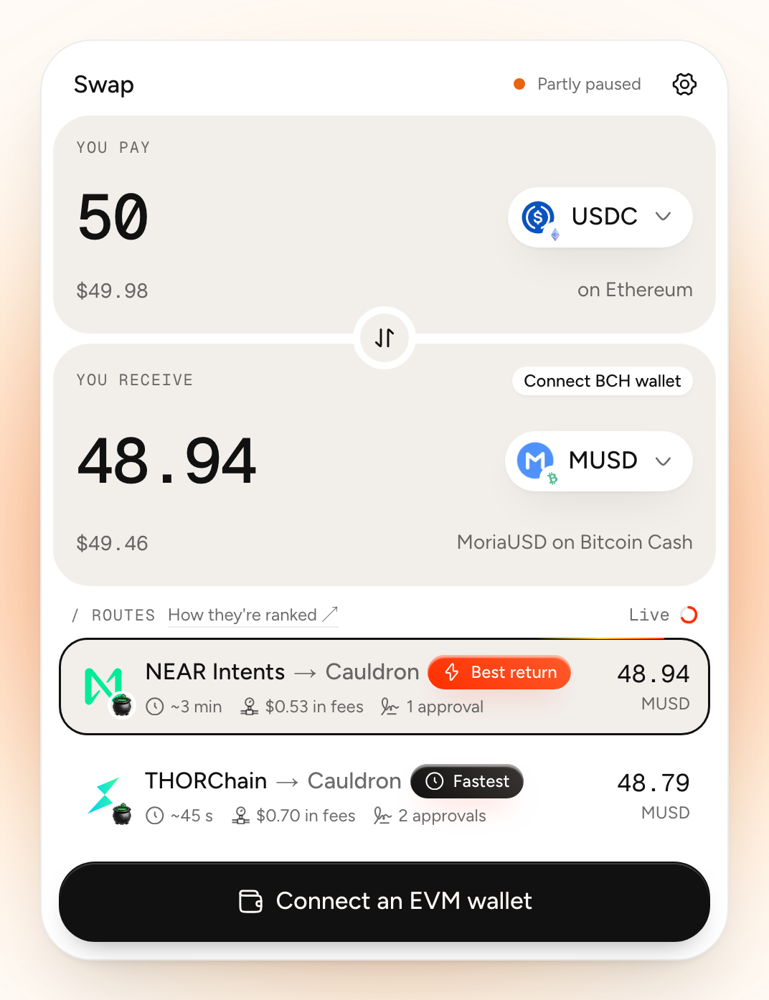
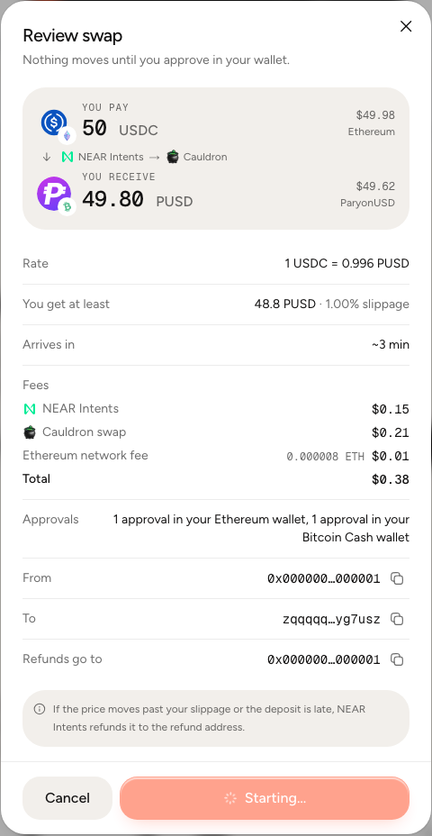
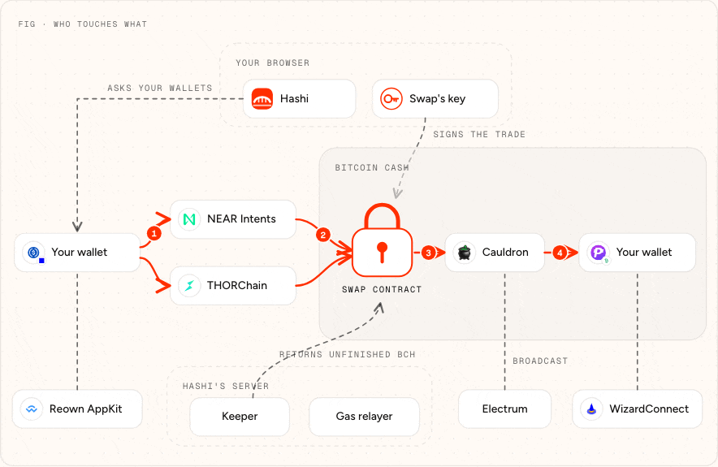
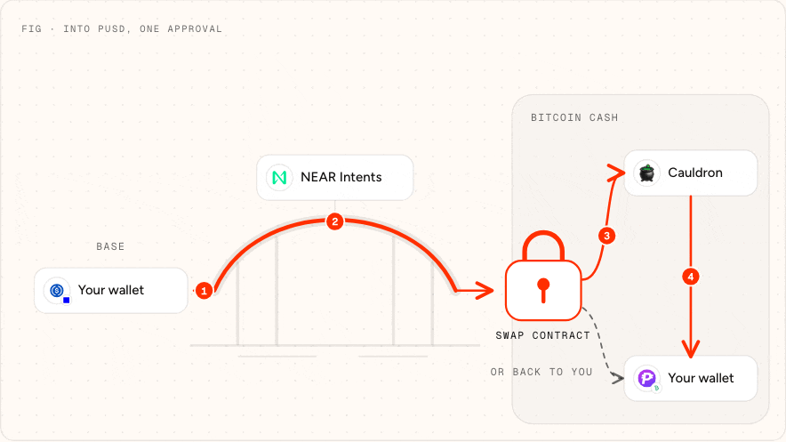
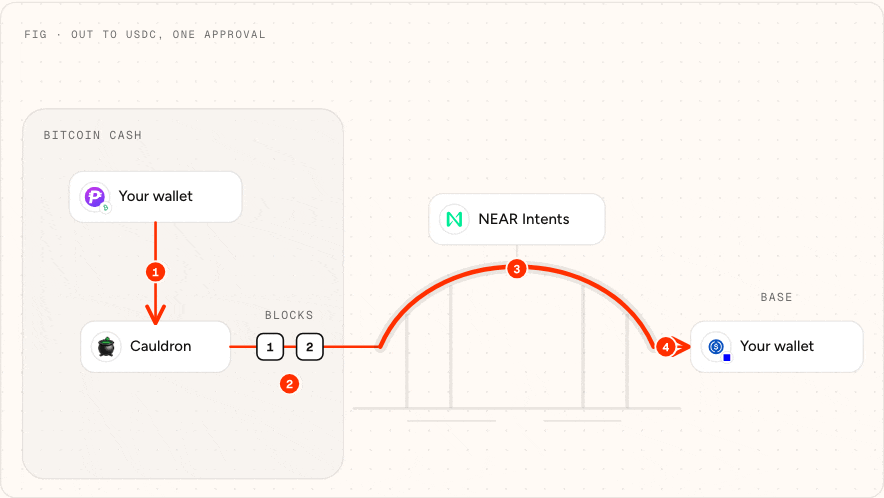

# Hashi · 橋

**Dollars in, dollars out.** Bring USDC or USDT from eight chains to Bitcoin Cash as PUSD, MUSD or BCH, and back, from one screen.

Hashi is a bridge between the stablecoins of the big chains and Bitcoin Cash's own dollars. You pick what you pay (USDC or USDT on Base, Ethereum, Arbitrum, Optimism, Polygon, Avalanche, BNB Chain or Solana) and what you receive (PUSD, MUSD or BCH). Hashi prices every route that can carry the swap, with NEAR Intents or THORChain crossing the chains and Cauldron trading on Bitcoin Cash. It shows every fee and ranks the routes by what you keep. Then it walks your two wallets through the approvals: WalletConnect (Reown AppKit) on the other chain and WizardConnect on Bitcoin Cash. Through NEAR Intents that is one approval either way: the deposit going in, the sale coming out. The same screen also swaps PUSD, MUSD and BCH on Bitcoin Cash alone.

Built for the BCH BLAZE 2026 Stablecoin Bridge bounty. _Hashi_ (橋) is Japanese for bridge.

**Watch:** https://youtu.be/bbLQ44UAdBU (2:40) and, signed live, https://youtu.be/ZGtYV9u5jW8 (3:10) · **Try it:** https://hashi.cash · **Docs:** https://docs.hashi.cash · **Code:** https://github.com/Blockchain-Oracle/hashi

**Widget Factory deck:** https://docs.google.com/presentation/d/1GsuhBp2tMZBT6PexcLFE3e43yriJf5NbqJEEuzlpjQ4/edit?usp=sharing · **CashTokens address** (prizes and EMBER2026 votes): `bitcoincash:zqnvys4cpkjk9qtsmjwmhysgtlm9vvf6uvms3x8sh9`

## Demo video

2:40 on YouTube: Abu's intro, then real swaps on mainnet both ways, with how each part works drawn while the chains confirm.

**Live on mainnet (3:10): https://youtu.be/ZGtYV9u5jW8.** Abu signs a swap on camera: 1 USDC on Base in, 0.98 PUSD in his Cashonize wallet out, in one approval, with BaseScan and the wallet's receipt as proof. Both videos play with chapters at https://hashi.cash/demo.

## The problem

Most of the world's digital dollars are USDC and USDT on Ethereum, Base, Solana and a few other chains. Bitcoin Cash has dollars of its own: PUSD and MUSD, tokens that trade on Cauldron, a market on Bitcoin Cash. Today, someone holding USDC on Base who wants PUSD has to:

1. find a cross-chain swap that takes USDC and pays out BCH, Bitcoin Cash's own coin;
2. receive that BCH at a plain Bitcoin Cash address (NEAR Intents refuses the token-aware kind PUSD needs);
3. open Cauldron, connect a Bitcoin Cash wallet and swap the BCH for PUSD;
4. add up every hop's fees by hand to learn what the trip cost.

Going back is the same list in reverse, with a different wallet and address to get right at each step.

The cross-chain services (NEAR Intents, THORChain and the apps built on them) stop at plain BCH: none of them lists PUSD or MUSD. Cauldron stops at the edge of Bitcoin Cash. Nothing prices the whole trip, so nobody can tell which way is cheapest before they start.

## The idea

Hashi joins the two ends. You pick an amount, see every route priced end to end with its fees, and approve in your own wallet: once, either way, through NEAR Intents. Hashi builds each transaction, sends it and watches the bridge. It never holds the money and adds no fee of its own.

**A real quote.** Asking for 50 USDC on Ethereum → MUSD on 18 November 2026 at 19:13 UTC gave two routes:

- **NEAR Intents → Cauldron, Best return:** 48.94 MUSD, about 3 minutes, $0.53 in fees, 1 approval (the USDC transfer; the Cauldron trade runs by itself).
- **THORChain → Cauldron, Fastest:** 48.79 MUSD, about 45 seconds, $0.70 in fees, 2 approvals (allow, then deposit).

With the NEAR Intents route, you approve one USDC transfer. NEAR Intents pays the BCH to a Bitcoin Cash contract made for your swap, and while the tracker is open (now, or when you come back), Hashi trades it for MUSD on Cauldron with that swap's own key. The contract pays you at least the review's "you get at least", or sends the BCH back to you; if prices stay under that floor or the tracker isn't opened again, Hashi's server keeps the contract's public terms and returns the BCH to your wallet about two hours after the start.

## How it works

1. **Price.** For each route, Hashi asks the bridge for a quote and Cauldron's Router for the Bitcoin Cash leg. It then adds every fee: the bridge's, Cauldron's 0.1%, the Bitcoin Cash network fee, and the gas on the paying chain. Routes are ranked by what you keep.
2. **Start.** The bridge issues a real deposit address (NEAR Intents) or names its vault and memo (THORChain). The swap is saved in your browser before anything moves.
3. **Deposit.** One transfer from your EVM or Solana wallet. THORChain also needs an "allow" first.
4. **Bridge.** Hashi checks the bridge every 5 seconds and reads Bitcoin Cash blocks live, so the tracker says who has your money and what they wait for ("waiting for block 2 of 2"), with a countdown only where the bridge gives one. You can close the tab: the bridge carries on, and the tracker picks up where it stopped when you return.
5. **Finish on Bitcoin Cash, with no approval.** For PUSD or MUSD the bridge paid this swap's contract; while the tracker is open, Hashi signs the Cauldron trade with the swap's own key, after checking it in the Bitcoin Cash VM. The contract makes that trade pay you at least the floor.
6. **The way back, in one approval.** The Cauldron sale of your PUSD or MUSD pays its BCH straight to NEAR Intents' deposit address, under a quote that takes a range of amounts; Hashi checks the sale still keeps the review's promise before you sign. Through THORChain the sale comes first, then the BCH goes with THORChain's memo (two approvals).

## How Hashi meets the bounty

- _"convert stablecoins on other chains to BCH stablecoins (eg USDC on ETH into PUSD on BCH)"_: USDC or USDT on eight chains → PUSD, MUSD or BCH.
- _"And vice-versa, BCH stables to other-chain stables (eg PUSD on BCH into USDC on ETH)"_: PUSD, MUSD or BCH → USDC or USDT on any of the eight chains.
- _"from BCH stables to multiple/any other ecosystems would be even better"_: eight chains, seven EVM chains and Solana, 14 stablecoins.
- _"The faster, cheaper, and easier to use the bridge is - the better."_: routes ranked by what you keep after every fee, the fastest marked, one approval each way through NEAR Intents, a live tracker that counts Bitcoin Cash blocks, and a closed tab resumes where it stopped.
- _"On the BCH side, WizardConnect is highly recommended."_: every transaction from your Bitcoin Cash wallet is signed over WizardConnect.
- _"On the other chain side, WalletConnect is probably essential"_: Reown AppKit for EVM chains and Solana.
- Stretch, _"supporting multiple would be better"_: PUSD and MUSD, plus BCH itself.
- Stretch, _"route through large popular and existing multicoin providers like ShapeShift, ThorChain etc."_: THORChain and NEAR Intents side by side, priced against each other.
- _"ParyonUSD ... first priority integration & demo purposes"_: PUSD is the default destination.

The docs walk through the bounty line by line: https://docs.hashi.cash/docs/build/bounty

## Proof on mainnet

Real swaps through the live app, from our own wallets, on 18 November 2026:

- 2 USDC on Base → 1.98 PUSD in one approval, filmed for the demo: NEAR Intents paid 966,878 sats to the swap's contract, and Hashi traded them into 1.98 PUSD for the wallet with no prompt ([92ba9341…](https://explorer.salemkode.com/tx/92ba9341c9946e09f8d55a8b9d3b3102933a186c043d7d0791d2c2fd89ebca2f) and [dbc55dbc…](https://explorer.salemkode.com/tx/dbc55dbc1e5db0213cb5e9a3f26c568bc0e220a0661f3d357e67a70160204eb8), block 977,933).
- 1 PUSD → 0.980986 USDC on Base in one approval, filmed: the Cauldron sale paid NEAR's deposit address directly ([6bd4afb7…](https://explorer.salemkode.com/tx/6bd4afb7c67530a910a0e787b83a64d02083d09462d872a8dc90a043b327a3ef), block 977,933), and the USDC landed on Base at 20:41 UTC ([0xfaff342d…](https://basescan.org/tx/0xfaff342df7ddaa5046b061c6a17737584b254e1bb62961952549222a2f2056ed)).
- 0.97 PUSD → 0.79 MUSD on Bitcoin Cash alone, filmed: one Cauldron transaction ([d65dc335…](https://explorer.salemkode.com/tx/d65dc33549303afff71ef299b9bfcfdc1b3a4ee1f90633e171b396a2a8ee8ecf)), done seconds after the approval.
- USDC → 0.47 MUSD in one approval: NEAR Intents paid 238,643 sats to the swap's contract, and Hashi traded them into 0.47 MUSD for the wallet with no prompt ([6c9b4d5c…](https://explorer.salemkode.com/tx/6c9b4d5c515b549baae2fcf141bf20411e5c0f307b71c3e25f8aaa9fdf35b1a3) and [7615fc9a…](https://explorer.salemkode.com/tx/7615fc9afd258ccff168e95320ecc55099d3bcdf926dd4c9b143b8ececfab450), block 977,918).
- 0.10 MUSD → 0.09683 USDC on Base in one approval: the Cauldron sale paid NEAR's deposit address directly ([bd9b2485…](https://explorer.salemkode.com/tx/bd9b24855bfd4856104c2ec95d323562171f930cf12e14eca78b290be6011d35), block 977,925), and the USDC landed on Base ([0xa7cdf7d7…](https://basescan.org/tx/0xa7cdf7d76a93d198856fa375b2cac76d7d6a2dcce0b142d4438281dd1971741a)).
- 0.48 PUSD → 0.476685 USDC on Base: sale [ad371984…](https://explorer.salemkode.com/tx/ad37198428ca2f0e07402201a4cb70a0ccbf095689dc093ff71dae21b20e42f2), deposit [ca03b618…](https://explorer.salemkode.com/tx/ca03b618e60de620d16436c1a7a1ba6392d974a01c59e93b7d34b388f33de893), USDC on Base in [0xfada41b1…](https://basescan.org/tx/0xfada41b1558724633cdca4725ebbcab82c26952eb60b74a95541bf6212a36165) 33 minutes after the deposit (two approvals, before the one-transaction sale).

## Also in Hashi

- Swaps that stay on Bitcoin Cash: PUSD ⇄ MUSD ⇄ BCH on Cauldron, one approval, done seconds after you approve.
- A tracker and an Activity list: every swap step by step across both chains, with explorer links, saved in your browser, and a live panel that counts Bitcoin Cash blocks and shows the bridge's own countdown.
- Services checked live: NEAR Intents, THORChain's pauses per chain, the Cauldron Router and the Bitcoin Cash network.
- Settings for slippage and for a different recipient, with guards against token contracts and the wrong chain.
- Docs: 33 pages with real captures, diagrams, `llms.txt` and every page as Markdown.

## How the trip runs

- One approval each way through NEAR Intents; THORChain is priced beside it, and its way out takes two (the sale, then the BCH with THORChain's memo).
- Selling waits for two Bitcoin Cash blocks, about 20 minutes, which is when NEAR Intents takes the deposit; the tracker counts them live, then shows NEAR's own countdown.
- Hashi never holds the money: a bridge carries it across for minutes, and your wallets sign everything else.
- Your swap's key stays in your browser: the automatic trade runs while the tracker is open, and if you never come back the contract returns the BCH to your wallet about two hours after the start.
- No account: swaps are saved in your browser; the server keeps only each swap contract's public terms.

Hashi was started on 16 November 2026, during BCH BLAZE 2026. Its code is MIT-licensed.
