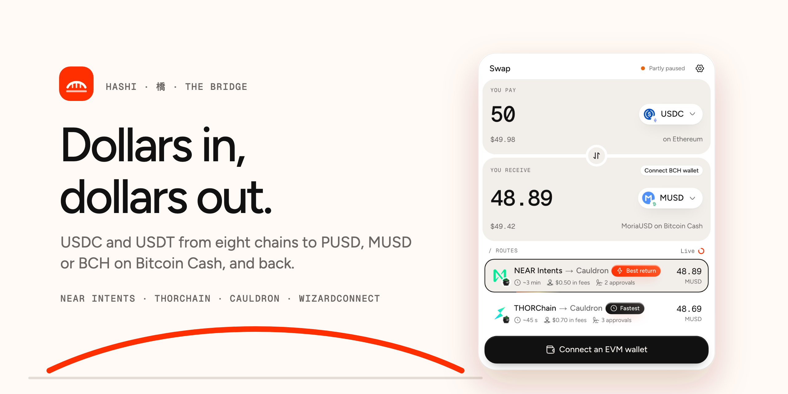
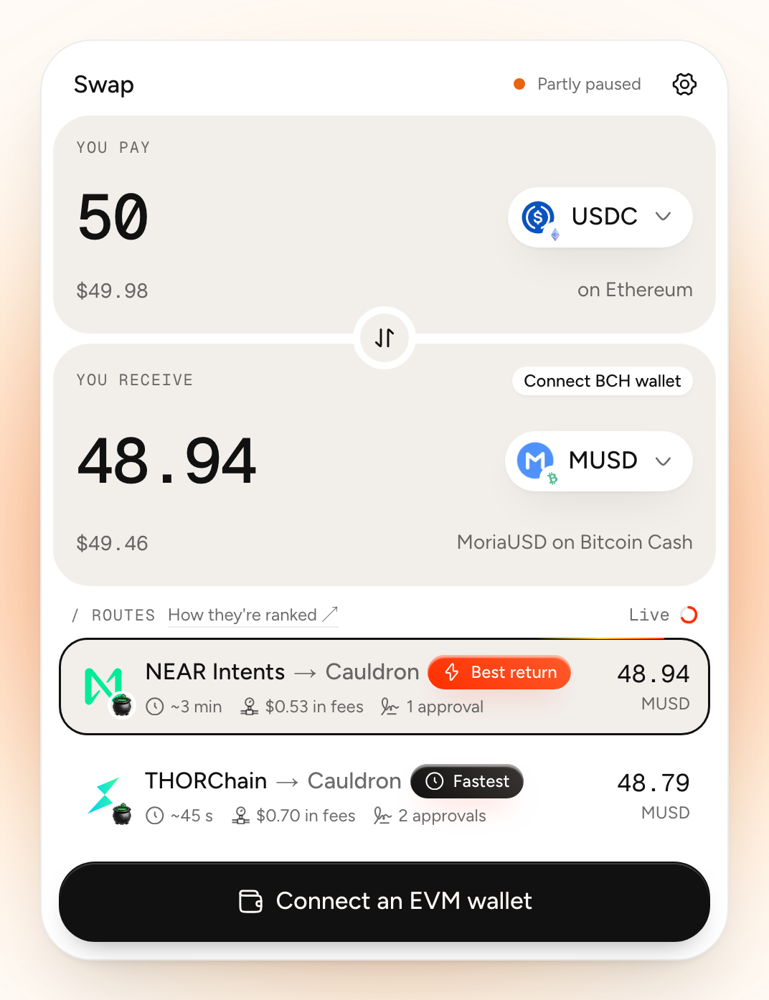
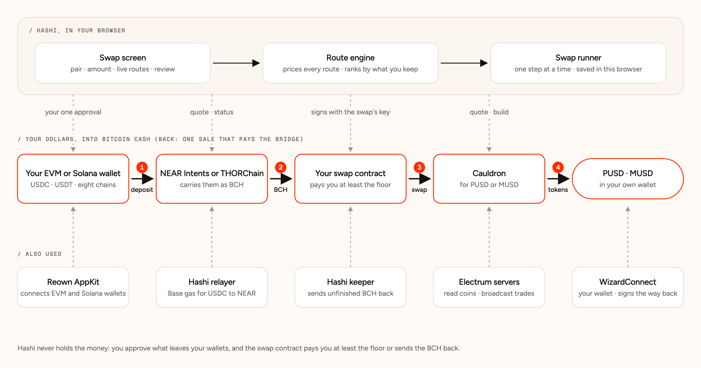
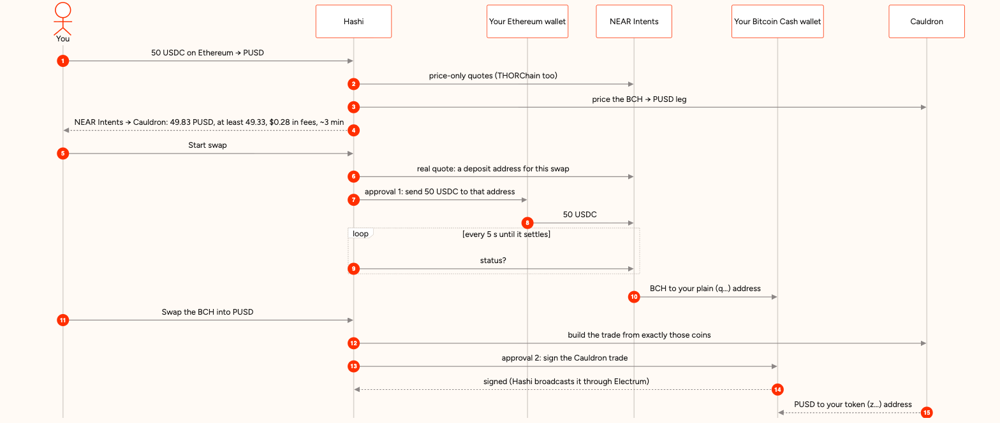

<p align="center">
  <a href="http://hashi.84.46.247.92.sslip.io">
    <picture>
      <source media="(prefers-color-scheme: dark)" srcset=".github/assets/banner-dark.png" />
      <source media="(prefers-color-scheme: light)" srcset=".github/assets/banner-light.png" />
      
    </picture>
  </a>
</p>

<h1 align="center">Hashi · 橋</h1>
<p align="center"><b>Dollars in, dollars out.</b><br/>Bring USDC or USDT from eight chains to Bitcoin Cash as PUSD, MUSD or BCH, and back, from one screen.</p>

<p align="center">
  <a href="http://hashi.84.46.247.92.sslip.io"><b>Open the app</b></a>
  &nbsp;·&nbsp;
  <a href="#demo-video"><b>Demo video</b></a>
  &nbsp;·&nbsp;
  <a href="http://docs.hashi.84.46.247.92.sslip.io"><b>Docs</b></a>
  &nbsp;·&nbsp;
  <a href="#how-hashi-meets-the-hackathon"><b>How it meets the bounty</b></a>
</p>

Hashi is a bridge between the stablecoins of the big chains and Bitcoin Cash's own dollars. You pick what you pay (USDC or USDT on Base, Ethereum, Arbitrum, Optimism, Polygon, Avalanche, BNB Chain or Solana) and what you receive (**PUSD**, **MUSD** or **BCH**). Hashi prices every route that can carry the swap, with **NEAR Intents** or **THORChain** crossing the chains and **Cauldron** trading on Bitcoin Cash. It shows every fee and ranks the routes by what you keep. Then it walks your two wallets through each approval: **WalletConnect** (Reown AppKit) on the other chain and **WizardConnect** on Bitcoin Cash. The same screen does the way back, and swaps between PUSD, MUSD and BCH that stay on Bitcoin Cash.

Built for **BCH BLAZE 2026 · Stablecoin Bridge bounty**. Jump to [how Hashi meets the hackathon](#how-hashi-meets-the-hackathon).

*Hashi* (橋) is Japanese for bridge. Its mark is the arched drum bridge of Japanese gardens, lacquered vermilion.

## The problem

Most of the world's digital dollars are USDC and USDT on Ethereum, Base, Solana and a few other chains. Bitcoin Cash has dollars of its own: PUSD and MUSD, tokens that trade on Cauldron, a market on Bitcoin Cash. Today, someone holding USDC on Base who wants PUSD has to:

1. find a cross-chain swap that takes USDC and pays out BCH, Bitcoin Cash's own coin;
2. receive that BCH at a plain Bitcoin Cash address (NEAR Intents refuses the token-aware kind PUSD needs);
3. open Cauldron, connect a Bitcoin Cash wallet and swap the BCH for PUSD;
4. add up every hop's fees by hand to learn what the trip cost.

Going back is the same list in reverse, with a different wallet and address to get right at each step.

The cross-chain services (NEAR Intents, THORChain and the apps built on them) stop at plain BCH: none of them lists PUSD or MUSD. Cauldron stops at the edge of Bitcoin Cash. Nothing prices the whole trip, so nobody can tell which way is cheapest before they start.

## The idea

Hashi joins the two ends. You pick an amount, see every route priced end to end with its fees, and approve each step in your own wallets. Hashi builds each transaction, sends it, watches the bridge and asks for the next approval. It never holds the money and adds no fee of its own.

**A real quote.** Asking for 50 USDC on Ethereum → MUSD on 17 November 2026 at 00:21 UTC gave two routes:

| Route | You receive | Time | Fees | Approvals |
|---|---|---|---|---|
| NEAR Intents → Cauldron · **Best return** | **48.89 MUSD** | about 3 min | $0.50 | 2: one in your Ethereum wallet, one in your Bitcoin Cash wallet |
| THORChain → Cauldron · **Fastest** | 48.69 MUSD | about 45 s | $0.70 | 3: allow, deposit, then the Cauldron swap |

<p align="center">
  <picture>
    <source media="(prefers-color-scheme: dark)" srcset=".github/assets/captures/swap-card-dark.png" />
    
  </picture>
</p>

With the NEAR Intents route, you approve one USDC transfer. NEAR Intents delivers BCH to your Bitcoin Cash wallet, and one more approval swaps it for MUSD on Cauldron. The review shows the least you can receive with both legs' slippage counted, and every Cauldron trade is built with that floor. If prices move past it, nothing is signed. Hashi tells you what the trade would give now and lets you choose.

## Demo video

<p align="center">
  <a href="http://hashi.84.46.247.92.sslip.io/swap?from=USDC.ethereum&to=MUSD&amount=50">
    
  </a>
</p>

The cover opens the same swap on the live app. The recorded walkthrough will be linked here and on the cover. You can also follow it yourself:

1. Open [the app on this swap](http://hashi.84.46.247.92.sslip.io/swap?from=USDC.ethereum&to=MUSD&amount=50): live routes from NEAR Intents, THORChain and Cauldron, refreshed every 15 seconds.
2. Press the pay or receive token to try any pair: 14 stablecoins on eight chains, or PUSD ⇄ MUSD ⇄ BCH on Bitcoin Cash alone.
3. Open the [docs home](http://docs.hashi.84.46.247.92.sslip.io): pick a start and a destination, and the bridge drawn there lights the real route and its approvals.

## How it works

1. **Price.** For each route, Hashi asks the bridge for a quote (NEAR Intents' 1Click API, or THORChain's node API) and Cauldron's Router for the Bitcoin Cash leg. It then adds every fee: the bridge's, Cauldron's 0.1%, the Bitcoin Cash network fee, and the gas on the paying chain, measured on each chain. Routes are ranked by what you keep.
2. **Start.** The bridge issues a real deposit address (NEAR Intents) or names its vault and memo (THORChain). The swap is saved in your browser before anything moves.
3. **Deposit.** One transfer from your EVM or Solana wallet. THORChain also needs an "allow" first. USDC on Base can go gasless: you sign, and Hashi's relayer pays the gas.
4. **Bridge.** Hashi checks the bridge every 5 seconds. You can close the tab: the BCH arrives on its own.
5. **Finish on Bitcoin Cash.** For PUSD or MUSD, one WizardConnect approval signs the Cauldron trade that Hashi built from the BCH that arrived. Hashi broadcasts it through Electrum servers.
6. **The way back** sells PUSD or MUSD on Cauldron first. The sale is saved the moment it is out, then the bridge is quoted for exactly the BCH it produced.

<p align="center">
  <a href="http://docs.hashi.84.46.247.92.sslip.io/docs/build">
    <picture>
      <source media="(prefers-color-scheme: dark)" srcset=".github/assets/system-dark.png" />
      
    </picture>
  </a>
</p>
<p align="center"><a href="http://docs.hashi.84.46.247.92.sslip.io/docs/build">Open the detailed map</a> · <a href=".github/diagrams/system.py">Edit the source</a></p>

<p align="center">
  <a href="http://docs.hashi.84.46.247.92.sslip.io/docs/routes">
    <picture>
      <source media="(prefers-color-scheme: dark)" srcset=".github/assets/into-bch-dark.png" />
      
    </picture>
  </a>
</p>
<p align="center"><a href="http://docs.hashi.84.46.247.92.sslip.io/docs/routes">Every route, step by step</a> · <a href=".github/diagrams/into-bch.mmd">Edit the Mermaid source</a> (also <a href=".github/diagrams/out-of-bch.mmd">out of</a> and <a href=".github/diagrams/on-bch.mmd">on</a> Bitcoin Cash)</p>

### Built on

| Piece | What it does in Hashi | Where in the code |
|---|---|---|
| [NEAR Intents](https://near-intents.org) (1Click API) | Quotes, deposit addresses and status on all eight chains | [`lib/providers/near.ts`](apps/web/lib/providers/near.ts) |
| [THORChain](https://thorchain.org) | Quotes, vaults and memos, halts, status; the Bitcoin Cash deposit is built to its rules | [`lib/providers/thorchain.ts`](apps/web/lib/providers/thorchain.ts), [`lib/bch/tx.ts`](apps/web/lib/bch/tx.ts) |
| [Cauldron](https://cauldron.quest) Router and indexer | PUSD, MUSD and BCH trades built from your own coins; live liquidity on the landing page | [`lib/providers/cauldron.ts`](apps/web/lib/providers/cauldron.ts), [`lib/bch/cauldron-trade.ts`](apps/web/lib/bch/cauldron-trade.ts) |
| [WizardConnect](https://docs.riftenlabs.com/wizardconnect) | Connects Selene, Paytaca, Cashonize or Electron Cash, and signs every Bitcoin Cash transaction | [`features/wallets/bch-wallet.tsx`](apps/web/features/wallets/bch-wallet.tsx), [`lib/bch/sign.ts`](apps/web/lib/bch/sign.ts) |
| [Reown AppKit](https://reown.com/appkit) (WalletConnect) | EVM and Solana wallets: transfers, THORChain deposits, gasless signatures | [`features/wallets/evm-wallet.tsx`](apps/web/features/wallets/evm-wallet.tsx), [`lib/evm/`](apps/web/lib/evm) |
| [ParyonUSD](https://paryonusd.com) and [Moria](https://moria.money) | PUSD and MUSD, the Bitcoin Cash dollars | [`lib/constants/assets.ts`](apps/web/lib/constants/assets.ts) |
| Electrum (Fulcrum servers) | Your coins with their tokens, live, and every broadcast | [`lib/bch/electrum.ts`](apps/web/lib/bch/electrum.ts) |

## How Hashi meets the hackathon

The bounty, in the organiser's words: *"Build a project that allows users to bridge or swap stablecoins into & out of BCH - Ie. to be able to convert stablecoins on other chains to BCH stablecoins (eg USDC on ETH into PUSD on BCH)"*.

| Requirement (verbatim) | How Hashi meets it | Check it |
|---|---|---|
| "convert stablecoins on other chains to BCH stablecoins (eg USDC on ETH into PUSD on BCH)" | USDC or USDT on eight chains → PUSD, MUSD or BCH, through NEAR Intents or THORChain, then Cauldron | [the app](http://hashi.84.46.247.92.sslip.io/swap?from=USDC.ethereum&to=PUSD&amount=50), [`lib/engine/quote.ts`](apps/web/lib/engine/quote.ts) |
| "And vice-versa, BCH stables to other-chain stables (eg PUSD on BCH into USDC on ETH)" | PUSD, MUSD or BCH → USDC or USDT on any of the eight chains | [the app](http://hashi.84.46.247.92.sslip.io/swap?from=PUSD&to=USDC.ethereum&amount=20), [`lib/engine/runner.ts`](apps/web/lib/engine/runner.ts) |
| "from BCH stables to multiple/any other ecosystems would be even better" | Eight chains: seven EVM chains and Solana, 14 stablecoins | [Chains and assets](http://docs.hashi.84.46.247.92.sslip.io/docs/routes/chains-and-assets) |
| "The faster, cheaper, and easier to use the bridge is - the better." | Routes ranked by what you keep after every fee, with the fastest marked; one screen; gasless USDC on Base; a closed tab resumes where it stopped | [How a route is priced](http://docs.hashi.84.46.247.92.sslip.io/docs/routes/pricing) |
| "On the BCH side, WizardConnect is highly recommended." | Every Bitcoin Cash transaction is signed over WizardConnect | [`features/wallets/bch-wallet.tsx`](apps/web/features/wallets/bch-wallet.tsx) |
| "On the other chain side, WalletConnect is probably essential" | Reown AppKit (WalletConnect and browser wallets) for EVM chains and Solana | [`features/wallets/evm-wallet.tsx`](apps/web/features/wallets/evm-wallet.tsx) |
| Stretch: "supporting multiple would be better" | PUSD and MUSD, plus BCH itself | [PUSD and MUSD](http://docs.hashi.84.46.247.92.sslip.io/docs/bitcoin-cash/pusd-and-musd) |
| Stretch: "route through large popular and existing multicoin providers like ShapeShift, ThorChain etc." | THORChain and NEAR Intents side by side, priced against each other | [Every route](http://docs.hashi.84.46.247.92.sslip.io/docs/routes) |
| "ParyonUSD is sponsoring BLAZE this year, so they are an excellent choice for first priority integration & demo purposes." | PUSD is the default destination | [the app](http://hashi.84.46.247.92.sslip.io/swap) |
| "Must have WizardConnect or XO Template integration" | WizardConnect | above |
| "Must be able to make BCH mainnet transactions" | Every swap into PUSD or MUSD, every sale and every swap on Bitcoin Cash is a mainnet transaction you sign | [`lib/bch/sign.ts`](apps/web/lib/bch/sign.ts) |
| "Must have a banner with" the Widget Factory deck, the repository and a CashTokens address | The top of the [home page](http://hashi.84.46.247.92.sslip.io) | [`components/shell/blaze-banner.tsx`](apps/web/components/shell/blaze-banner.tsx) |

The docs walk through [the bounty line by line](http://docs.hashi.84.46.247.92.sslip.io/docs/build/bounty).

## Proof and evidence

- **Live app and docs**, deployed from this repository: [the app](http://hashi.84.46.247.92.sslip.io) and [the docs](http://docs.hashi.84.46.247.92.sslip.io).
- **Live quotes with their time**: the worked example above (17 Nov 2026, 00:21 UTC) and the captures in [`.github/assets/captures`](.github/assets/captures), each read from the production build.
- **Cauldron builds checked live**, unsigned: a token-to-token build of 10 PUSD → 9.74 MUSD through 54 pools (16 Nov 2026), and the slippage floor refusing a build below it.
- **THORChain memos checked live** (17 Nov 2026): a refund address fits the memo from an EVM chain, not from Bitcoin Cash, and the `bitcoincash:` prefix breaks THORChain's parser. Hashi handles both.
- **70 tests** on the parts where a mistake costs money: decimals and fee maths, route ranking, cashaddr conversion, the THORChain deposit builder (vault at output 0, memo, change to input 0), quote deadlines, the swap timeline. Run `pnpm test`.

### The rest of Hashi

- **Swaps that stay on Bitcoin Cash**: PUSD ⇄ MUSD ⇄ BCH on Cauldron, one approval, about 15 seconds ([guide](http://docs.hashi.84.46.247.92.sslip.io/docs/guide/on-bitcoin-cash)).
- **Tracker and Activity**: every swap step by step across both chains, with explorer links, saved in your browser. A closed tab resumes where it stopped ([guide](http://docs.hashi.84.46.247.92.sslip.io/docs/guide/activity)).
- **Gasless USDC on Base**: sign an authorisation and Hashi's relayer pays the gas ([guide](http://docs.hashi.84.46.247.92.sslip.io/docs/guide/gasless)).
- **Services checked live**: NEAR Intents, THORChain's pauses per chain, the Cauldron Router and the Bitcoin Cash network, in the swap card's status ([guide](http://docs.hashi.84.46.247.92.sslip.io/docs/guide/swap-screen)).
- **Settings**: slippage, and a different recipient with guards against token contracts and the wrong chain ([guide](http://docs.hashi.84.46.247.92.sslip.io/docs/guide/settings)).
- **The docs**: 32 pages in four parts, with real captures, the diagrams, `llms.txt` and every page as Markdown.

## Run it locally

Needs Node 24 and pnpm 11.

```bash
pnpm install
cp apps/web/.env.example apps/web/.env.local   # add a free Reown project id; the relayer key is optional
pnpm dev                                        # the app on http://localhost:3030
pnpm test                                       # the tests
```

The docs are their own project: `cd docs-site && pnpm install && pnpm dev` (port 3032). Both have Dockerfiles: `apps/web/Dockerfile` (built from the repository root) and `docs-site/Dockerfile`.

```
apps/web/            the app: landing page, swap, activity, tracker, gas relayer (Next.js)
  lib/engine/        quotes, fees, ranking, the swap runner and its saved record
  lib/providers/     NEAR Intents, THORChain, Cauldron
  lib/bch/           addresses, coins, Electrum, Cauldron trades, the THORChain deposit, signing
  features/          swap screen, wallets, activity and tracker, landing page
docs-site/           the docs (Fumadocs, static export)
.github/             diagrams, captures, banner
```

## Credits

Third-party components, fonts and logos are listed with their licences in [THIRD_PARTY_NOTICES.md](THIRD_PARTY_NOTICES.md). Network and token logos belong to their owners and are used only to name the services Hashi connects to. Hashi was started on 16 November 2026, during BCH BLAZE 2026. It has no earlier version.

## Honest limits

- **No swap has been completed end to end on mainnet yet.** The quotes, deposit addresses and unsigned Cauldron builds above are live. Every wallet step is built and checked in code, but waits for its first funded run. Its transaction ids will be listed here.
- **The live address is temporary and plain HTTP** until hashi.cash is registered, and wallets connect only over HTTPS.
- **Selling PUSD or MUSD takes two approvals** (sell, then send). Paying the bridge straight from the sale, in one approval, is built but not yet proven.
- **Gasless deposits are off** until the relayer holds a little Base ETH; the normal deposit is offered instead.
- **Each bridge holds the money while it carries it**: NEAR Intents' bridge or THORChain's vaults, for seconds to minutes ([trust](http://docs.hashi.84.46.247.92.sslip.io/docs/routes/trust)).
- **Swaps are saved only in the browser that started them**; there is no account and no server copy.

## Licence

[MIT](LICENSE).
