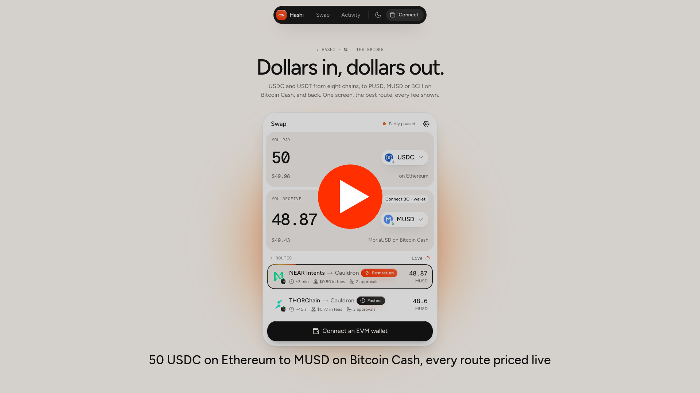

<p align="center">
  <a href="https://hashi.cash">
    <picture>
      <source media="(prefers-color-scheme: dark)" srcset=".github/assets/banner-dark.png" />
      <source media="(prefers-color-scheme: light)" srcset=".github/assets/banner-light.png" />
      
    </picture>
  </a>
</p>

<h1 align="center">Hashi · 橋</h1>
<p align="center"><b>Dollars in, dollars out.</b><br/>Bring USDC or USDT from eight chains to Bitcoin Cash as PUSD, MUSD or BCH, and back, from one screen.</p>

<p align="center">
  <a href="https://hashi.cash"><b>Open the app</b></a>
  &nbsp;·&nbsp;
  <a href="#demo-video"><b>Demo video</b></a>
  &nbsp;·&nbsp;
  <a href="https://docs.hashi.cash"><b>Docs</b></a>
  &nbsp;·&nbsp;
  <a href="#how-hashi-meets-the-hackathon"><b>How it meets the bounty</b></a>
  &nbsp;·&nbsp;
  <a href="https://docs.google.com/presentation/d/1GsuhBp2tMZBT6PexcLFE3e43yriJf5NbqJEEuzlpjQ4/edit?usp=sharing"><b>Widget Factory deck</b></a>
  &nbsp;·&nbsp;
  <a href="#cashtokens-address"><b>CashTokens address</b></a>
</p>

Hashi is a bridge between the stablecoins of the big chains and Bitcoin Cash's own dollars. You pick what you pay (USDC or USDT on Base, Ethereum, Arbitrum, Optimism, Polygon, Avalanche, BNB Chain or Solana) and what you receive (**PUSD**, **MUSD** or **BCH**). Hashi prices every route that can carry the swap, with **NEAR Intents** or **THORChain** crossing the chains and **Cauldron** trading on Bitcoin Cash. It shows every fee and ranks the routes by what you keep. Then it walks your two wallets through the approvals: **WalletConnect** (Reown AppKit) on the other chain and **WizardConnect** on Bitcoin Cash. Through NEAR Intents that is **one approval either way**: the deposit going in, the sale coming out. The same screen also swaps PUSD, MUSD and BCH on Bitcoin Cash alone.

Built for **BCH BLAZE 2026 · Stablecoin Bridge bounty**. Jump to [how Hashi meets the hackathon](#how-hashi-meets-the-hackathon).

_Hashi_ (橋) is Japanese for bridge. Its mark is the arched drum bridge of Japanese gardens, lacquered vermilion.

## The problem

Most of the world's digital dollars are USDC and USDT on Ethereum, Base, Solana and a few other chains. Bitcoin Cash has dollars of its own: PUSD and MUSD, tokens that trade on Cauldron, a market on Bitcoin Cash. Today, someone holding USDC on Base who wants PUSD has to:

1. find a cross-chain swap that takes USDC and pays out BCH, Bitcoin Cash's own coin;
2. receive that BCH at a plain Bitcoin Cash address (NEAR Intents refuses the token-aware kind PUSD needs);
3. open Cauldron, connect a Bitcoin Cash wallet and swap the BCH for PUSD;
4. add up every hop's fees by hand to learn what the trip cost.

Going back is the same list in reverse, with a different wallet and address to get right at each step.

The cross-chain services (NEAR Intents, THORChain and the apps built on them) stop at plain BCH: none of them lists PUSD or MUSD. Cauldron stops at the edge of Bitcoin Cash. Nothing prices the whole trip, so nobody can tell which way is cheapest before they start.

## The idea

Hashi joins the two ends. You pick an amount, see every route priced end to end with its fees, and approve in your own wallet. Going into PUSD or MUSD that is **one approval**: the bridge pays a Bitcoin Cash contract made for your swap, and Hashi turns the BCH into PUSD or MUSD on Cauldron without asking again. The contract pays you at least what the review promised, or sends the BCH back to you. Coming back is **one approval** too: the Cauldron sale pays NEAR Intents in the same transaction. Hashi never holds the money and adds no fee of its own.

**A real quote.** Asking for 50 USDC on Ethereum → MUSD on 18 November 2026 at 19:13 UTC gave two routes:

| Route                                     | You receive    | Time        | Fees  | Approvals                                                 |
| ----------------------------------------- | -------------- | ----------- | ----- | --------------------------------------------------------- |
| NEAR Intents → Cauldron · **Best return** | **48.94 MUSD** | about 3 min | $0.53 | 1: the USDC transfer; the Cauldron trade runs by itself   |
| THORChain → Cauldron · **Fastest**        | 48.79 MUSD     | about 45 s  | $0.70 | 2: allow, then deposit; the Cauldron trade runs by itself |

<p align="center">
  <picture>
    <source media="(prefers-color-scheme: dark)" srcset=".github/assets/captures/swap-card-dark.png" />
    
  </picture>
</p>

With the NEAR Intents route, you approve one USDC transfer. NEAR Intents pays the BCH to [a contract made for your swap](https://docs.hashi.cash/docs/bitcoin-cash/swap-contract), and while the tracker is open (now, or when you come back), Hashi trades it for MUSD on Cauldron with that swap's own key. The contract pays you at least the review's **You get at least**, or sends the BCH back to you. If prices stay under that floor until the refund time, or the tracker isn't opened again, nothing stays stuck: Hashi's server keeps the contract's public terms and returns the BCH to your wallet about two hours after the start.

## Demo video

<p align="center">
  <a href="https://hashi.cash/demo">
    
  </a>
</p>

**Watch on YouTube: https://youtu.be/bbLQ44UAdBU** (2:40). Abu introduces Hashi, then real swaps on mainnet from his own wallets, with drawings of how each part works while the chains confirm. Follow the proof:

1. **0:38 · USDC on Base → PUSD.** NEAR Intents, THORChain and Cauldron priced at once; the review shows every fee and one approval.
2. **0:58 · The swap contract.** NEAR Intents pays a contract made for the swap; Hashi trades it on Cauldron with the swap's own key, and 1.98 PUSD lands with no second prompt ([`dbc55dbc…`](https://explorer.salemkode.com/tx/dbc55dbc1e5db0213cb5e9a3f26c568bc0e220a0661f3d357e67a70160204eb8)).
3. **1:23 · The way back in one approval.** The Cauldron sale pays NEAR Intents in the same transaction ([`6bd4afb7…`](https://explorer.salemkode.com/tx/6bd4afb7c67530a910a0e787b83a64d02083d09462d872a8dc90a043b327a3ef)); the USDC lands on Base at 1:50 ([`0xfaff342d…`](https://basescan.org/tx/0xfaff342df7ddaa5046b061c6a17737584b254e1bb62961952549222a2f2056ed)).
4. **1:56 · On Bitcoin Cash alone.** PUSD → MUSD in one Cauldron transaction ([`d65dc335…`](https://explorer.salemkode.com/tx/d65dc33549303afff71ef299b9bfcfdc1b3a4ee1f90633e171b396a2a8ee8ecf)).
5. **Live, signed on camera: https://youtu.be/ZGtYV9u5jW8** (3:10). Abu swaps 1 USDC on Base ([`0x9dbc929d…`](https://basescan.org/tx/0x9dbc929d478c4474d891f3e86955c45daa2aa45dff9553115826d51303f378dd)) for 0.98 PUSD in Cashonize in one approval, explaining each step as he signs: NEAR Intents pays the swap's contract ([`8c2663a4…`](https://explorer.salemkode.com/tx/8c2663a4e5adbafcea4169659aa23f77a45820ffca960797ef8785b69fdfec1f)) and the contract buys PUSD and pays his wallet ([`9797a277…`](https://explorer.salemkode.com/tx/9797a2773881518131b13732d35faca5f70325ea1cc7523025d91b1a98a830c0)), both in block 978,016. Both videos play with chapters at [hashi.cash/demo](https://hashi.cash/demo).
6. **Try it yourself:** [the app on a 50 USDC → MUSD swap](https://hashi.cash/swap?from=USDC.ethereum&to=MUSD&amount=50), or the [docs home](https://docs.hashi.cash), where the bridge lights the real route for any pair.

## How it works

1. **Price.** For each route, Hashi asks the bridge for a quote (NEAR Intents' 1Click API, or THORChain's node API) and Cauldron's Router for the Bitcoin Cash leg. It then adds every fee: the bridge's, Cauldron's 0.1%, the Bitcoin Cash network fee, and the gas on the paying chain, measured on each chain. Routes are ranked by what you keep.
2. **Start.** The bridge issues a real deposit address (NEAR Intents) or names its vault and memo (THORChain). The swap is saved in your browser before anything moves.
3. **Deposit.** One transfer from your EVM or Solana wallet. THORChain also needs an "allow" first. USDC on Base can go gasless: you sign, and Hashi's relayer pays the gas.
4. **Bridge.** Hashi checks the bridge every 5 seconds and reads Bitcoin Cash blocks live, so the tracker says who has your money and what they wait for ("waiting for block 2 of 2"), with a countdown only where the bridge gives one. You can close the tab: the bridge carries on, and the tracker picks up where it stopped when you return.
5. **Finish on Bitcoin Cash, with no approval.** For PUSD or MUSD the bridge paid this swap's contract (P2SH, CashScript). Hashi builds the Cauldron trade from its BCH, signs it with the swap's own key, checks the whole transaction in the Bitcoin Cash VM and broadcasts it through Electrum servers. This runs while the tracker is open. The contract makes that trade pay you at least the floor; if it can't happen in time, the BCH goes back to your wallet, and you finish with one WizardConnect approval.
6. **The way back, in one approval.** NEAR Intents quotes a range of deposit amounts, and Hashi builds the Cauldron sale of your PUSD or MUSD with its BCH paid straight to NEAR's deposit address. Before you sign, it checks the sale pays at least NEAR's minimum and that NEAR still pays the review's **You get at least**. Through THORChain the sale comes first and is saved, then the BCH goes with THORChain's memo (two approvals).

<p align="center">
  <a href="https://docs.hashi.cash/docs/build">
    <picture>
      <source media="(prefers-color-scheme: dark)" srcset=".github/assets/figures/system-dark.gif" />
      
    </picture>
  </a>
</p>
<p align="center"><sub><b>Who touches what.</b> ① you approve in your wallet · ② NEAR Intents or THORChain carry it to your swap contract · ③ Hashi trades it on Cauldron with the swap's own key · ④ PUSD or MUSD to your wallet. Hashi's server only returns unfinished BCH.</sub></p>

<p align="center">
  <a href="https://docs.hashi.cash/docs/bitcoin-cash/swap-contract">
    <picture>
      <source media="(prefers-color-scheme: dark)" srcset=".github/assets/figures/into-dark.gif" />
      
    </picture>
  </a>
</p>
<p align="center"><sub><b>Into PUSD, one approval.</b> ① the USDC transfer · ② NEAR Intents pays the BCH to your swap's contract · ③ the swap's own key trades it on Cauldron · ④ at least the review's floor, to your wallet.</sub></p>

<p align="center">
  <a href="https://docs.hashi.cash/docs/routes">
    <picture>
      <source media="(prefers-color-scheme: dark)" srcset=".github/assets/figures/out-dark.gif" />
      
    </picture>
  </a>
</p>
<p align="center"><sub><b>Out to USDC, one approval.</b> ① the sale, which pays NEAR Intents in the same transaction · ② two Bitcoin Cash blocks · ③ NEAR Intents swaps it · ④ USDC to your wallet on Base.</sub></p>

<p align="center"><a href="https://docs.hashi.cash/docs/routes">Every route, step by step</a> · <a href="docs-site/components/figures">The figures' source</a> (drawn by hand in SVG; the docs play them live in light and dark)</p>

### Built on

| Piece                                                               | What it does in Hashi                                                                              | Where in the code                                                                                                                    |
| ------------------------------------------------------------------- | -------------------------------------------------------------------------------------------------- | ------------------------------------------------------------------------------------------------------------------------------------ |
| [NEAR Intents](https://near-intents.org) (1Click API)               | Quotes, deposit addresses and status on all eight chains                                           | [`lib/providers/near.ts`](apps/web/lib/providers/near.ts)                                                                            |
| [THORChain](https://thorchain.org)                                  | Quotes, vaults and memos, halts, status; the Bitcoin Cash deposit is built to its rules            | [`lib/providers/thorchain.ts`](apps/web/lib/providers/thorchain.ts), [`lib/bch/tx.ts`](apps/web/lib/bch/tx.ts)                       |
| [Cauldron](https://cauldron.quest) Router and indexer               | PUSD, MUSD and BCH trades built from your own coins; live liquidity on the landing page            | [`lib/providers/cauldron.ts`](apps/web/lib/providers/cauldron.ts), [`lib/bch/cauldron-trade.ts`](apps/web/lib/bch/cauldron-trade.ts) |
| [WizardConnect](https://docs.riftenlabs.com/wizardconnect)          | Connects Selene, Paytaca, Cashonize or Electron Cash, and signs every transaction from your wallet | [`features/wallets/bch-wallet.tsx`](apps/web/features/wallets/bch-wallet.tsx), [`lib/bch/sign.ts`](apps/web/lib/bch/sign.ts)         |
| [Reown AppKit](https://reown.com/appkit) (WalletConnect)            | EVM and Solana wallets: transfers, THORChain deposits, gasless signatures                          | [`features/wallets/evm-wallet.tsx`](apps/web/features/wallets/evm-wallet.tsx), [`lib/evm/`](apps/web/lib/evm)                        |
| [ParyonUSD](https://paryonusd.com) and [Moria](https://moria.money) | PUSD and MUSD, the Bitcoin Cash dollars                                                            | [`lib/constants/assets.ts`](apps/web/lib/constants/assets.ts)                                                                        |
| Electrum (Fulcrum servers)                                          | Your coins with their tokens, live, and every broadcast                                            | [`lib/bch/electrum.ts`](apps/web/lib/bch/electrum.ts)                                                                                |

## How Hashi meets the hackathon

The bounty, in the organiser's words: _"Build a project that allows users to bridge or swap stablecoins into & out of BCH - Ie. to be able to convert stablecoins on other chains to BCH stablecoins (eg USDC on ETH into PUSD on BCH)"_.

| Requirement (verbatim)                                                                                                     | How Hashi meets it                                                                                                                                                                                         | Check it                                                                                                                         |
| -------------------------------------------------------------------------------------------------------------------------- | ---------------------------------------------------------------------------------------------------------------------------------------------------------------------------------------------------------- | -------------------------------------------------------------------------------------------------------------------------------- |
| "convert stablecoins on other chains to BCH stablecoins (eg USDC on ETH into PUSD on BCH)"                                 | USDC or USDT on eight chains → PUSD, MUSD or BCH, through NEAR Intents or THORChain, then Cauldron                                                                                                         | [the app](https://hashi.cash/swap?from=USDC.ethereum&to=PUSD&amount=50), [`lib/engine/quote.ts`](apps/web/lib/engine/quote.ts)   |
| "And vice-versa, BCH stables to other-chain stables (eg PUSD on BCH into USDC on ETH)"                                     | PUSD, MUSD or BCH → USDC or USDT on any of the eight chains                                                                                                                                                | [the app](https://hashi.cash/swap?from=PUSD&to=USDC.ethereum&amount=20), [`lib/engine/runner.ts`](apps/web/lib/engine/runner.ts) |
| "from BCH stables to multiple/any other ecosystems would be even better"                                                   | Eight chains: seven EVM chains and Solana, 14 stablecoins                                                                                                                                                  | [Chains and assets](https://docs.hashi.cash/docs/routes/chains-and-assets)                                                       |
| "The faster, cheaper, and easier to use the bridge is - the better."                                                       | Routes ranked by what you keep after every fee, with the fastest marked; one approval each way through NEAR Intents; a live tracker that counts Bitcoin Cash blocks; a closed tab resumes where it stopped | [How a route is priced](https://docs.hashi.cash/docs/routes/pricing)                                                             |
| "On the BCH side, WizardConnect is highly recommended."                                                                    | Every transaction from your Bitcoin Cash wallet is signed over WizardConnect; a swap contract's trade is signed by that swap's own key, in your browser                                                    | [`features/wallets/bch-wallet.tsx`](apps/web/features/wallets/bch-wallet.tsx)                                                    |
| "On the other chain side, WalletConnect is probably essential"                                                             | Reown AppKit (WalletConnect and browser wallets) for EVM chains and Solana                                                                                                                                 | [`features/wallets/evm-wallet.tsx`](apps/web/features/wallets/evm-wallet.tsx)                                                    |
| Stretch: "supporting multiple would be better"                                                                             | PUSD and MUSD, plus BCH itself                                                                                                                                                                             | [PUSD and MUSD](https://docs.hashi.cash/docs/bitcoin-cash/pusd-and-musd)                                                         |
| Stretch: "route through large popular and existing multicoin providers like ShapeShift, ThorChain etc."                    | THORChain and NEAR Intents side by side, priced against each other                                                                                                                                         | [Every route](https://docs.hashi.cash/docs/routes)                                                                               |
| "ParyonUSD is sponsoring BLAZE this year, so they are an excellent choice for first priority integration & demo purposes." | PUSD is the default destination                                                                                                                                                                            | [the app](https://hashi.cash/swap)                                                                                               |
| "Must have WizardConnect or XO Template integration"                                                                       | WizardConnect                                                                                                                                                                                              | above                                                                                                                            |
| "Must be able to make BCH mainnet transactions"                                                                            | Every sale and every swap on Bitcoin Cash is a mainnet transaction you sign; swaps in end in the swap contract's own mainnet trade                                                                         | [the transactions below](#proof-on-mainnet)                                                                                      |
| "Must have a banner with" the Widget Factory deck, the repository and a CashTokens address                                 | The top of the [home page](https://hashi.cash); the address and its QR code are also [below](#cashtokens-address)                                                                                          | [`components/shell/blaze-banner.tsx`](apps/web/components/shell/blaze-banner.tsx)                                                |

The docs walk through [the bounty line by line](https://docs.hashi.cash/docs/build/bounty).

## CashTokens address

<p align="center">
  
</p>
<p align="center"><code>bitcoincash:zqnvys4cpkjk9qtsmjwmhysgtlm9vvf6uvms3x8sh9</code></p>

Hashi's token-aware Bitcoin Cash address, the one the banner shows. BCH BLAZE sends prizes here, and EMBER2026 holders vote for Hashi in Community Choice by sending their tokens here. Scan it with Paytaca, Selene or Cashonize.

## Proof on mainnet

Real swaps through the live app, from our own wallets, on 18 November 2026:

| Swap                                                                                              | Approvals                                                                                                                              | On chain                                                                                                                                                                                                                                                                                                                                                                                                                                                                               |
| ------------------------------------------------------------------------------------------------- | -------------------------------------------------------------------------------------------------------------------------------------- | -------------------------------------------------------------------------------------------------------------------------------------------------------------------------------------------------------------------------------------------------------------------------------------------------------------------------------------------------------------------------------------------------------------------------------------------------------------------------------------- |
| 2 USDC (Base) → **1.98 PUSD**, through NEAR Intents and the swap contract (filmed for the demo)   | **1**: the USDC transfer                                                                                                               | NEAR Intents paid 966,878 sats to the swap's contract ([`92ba9341…`](https://explorer.salemkode.com/tx/92ba9341c9946e09f8d55a8b9d3b3102933a186c043d7d0791d2c2fd89ebca2f)); Hashi traded them on Cauldron with the swap's own key, paying 1.98 PUSD to the wallet with no prompt ([`dbc55dbc…`](https://explorer.salemkode.com/tx/dbc55dbc1e5db0213cb5e9a3f26c568bc0e220a0661f3d357e67a70160204eb8)). Both in block 977,933                                                             |
| **1 PUSD** → 0.980986 USDC on Base, through NEAR Intents (filmed)                                 | **1**: the sale                                                                                                                        | The Cauldron sale paid 478,865 sats straight to NEAR's deposit address, in one transaction ([`6bd4afb7…`](https://explorer.salemkode.com/tx/6bd4afb7c67530a910a0e787b83a64d02083d09462d872a8dc90a043b327a3ef)), block 977,933; the USDC landed on Base at 20:41 UTC ([`0xfaff342d…`](https://basescan.org/tx/0xfaff342df7ddaa5046b061c6a17737584b254e1bb62961952549222a2f2056ed))                                                                                                      |
| 1 USDC (Base) → **0.98 PUSD**, through NEAR Intents and the swap contract (signed live on camera) | **1**: the USDC transfer ([`0x9dbc929d…`](https://basescan.org/tx/0x9dbc929d478c4474d891f3e86955c45daa2aa45dff9553115826d51303f378dd)) | NEAR Intents paid 474,881 sats to the swap's contract ([`8c2663a4…`](https://explorer.salemkode.com/tx/8c2663a4e5adbafcea4169659aa23f77a45820ffca960797ef8785b69fdfec1f)); Hashi traded them on Cauldron with the swap's own key, paying 0.98 PUSD to the wallet with no prompt ([`9797a277…`](https://explorer.salemkode.com/tx/9797a2773881518131b13732d35faca5f70325ea1cc7523025d91b1a98a830c0)). Both in block 978,016                                                             |
| **0.97 PUSD → 0.79 MUSD**, on Bitcoin Cash alone (filmed)                                         | **1**                                                                                                                                  | One Cauldron transaction ([`d65dc335…`](https://explorer.salemkode.com/tx/d65dc33549303afff71ef299b9bfcfdc1b3a4ee1f90633e171b396a2a8ee8ecf)), block 977,933, done seconds after the approval                                                                                                                                                                                                                                                                                           |
| USDC → **0.47 MUSD**, through NEAR Intents and the swap contract                                  | **1**: the USDC transfer                                                                                                               | NEAR Intents paid 238,643 sats to the swap's contract ([`6c9b4d5c…`](https://explorer.salemkode.com/tx/6c9b4d5c515b549baae2fcf141bf20411e5c0f307b71c3e25f8aaa9fdf35b1a3)); Hashi traded them on Cauldron with the swap's own key, paying 0.47 MUSD to the wallet with no prompt ([`7615fc9a…`](https://explorer.salemkode.com/tx/7615fc9afd258ccff168e95320ecc55099d3bcdf926dd4c9b143b8ececfab450)). Both in block 977,918                                                             |
| **0.10 MUSD** → 0.09683 USDC on Base, through NEAR Intents                                        | **1**: the sale                                                                                                                        | The Cauldron sale paid 48,253 sats straight to NEAR's deposit address, in one transaction ([`bd9b2485…`](https://explorer.salemkode.com/tx/bd9b24855bfd4856104c2ec95d323562171f930cf12e14eca78b290be6011d35)), block 977,925; the USDC landed on Base at 19:41 UTC ([`0xa7cdf7d7…`](https://basescan.org/tx/0xa7cdf7d76a93d198856fa375b2cac76d7d6a2dcce0b142d4438281dd1971741a))                                                                                                       |
| **0.48 PUSD** → 0.476685 USDC on Base, through NEAR Intents                                       | 2 (before the one-transaction sale was switched on)                                                                                    | Sale ([`ad371984…`](https://explorer.salemkode.com/tx/ad37198428ca2f0e07402201a4cb70a0ccbf095689dc093ff71dae21b20e42f2)) and deposit ([`ca03b618…`](https://explorer.salemkode.com/tx/ca03b618e60de620d16436c1a7a1ba6392d974a01c59e93b7d34b388f33de893)) in block 977,918; NEAR took it after the second block, and the USDC landed on Base 33 minutes after the deposit ([`0xfada41b1…`](https://basescan.org/tx/0xfada41b1558724633cdca4725ebbcab82c26952eb60b74a95541bf6212a36165)) |
| USDC → BCH → **0.48 PUSD**, the first run                                                         | 2 (before the swap contract)                                                                                                           | NEAR Intents paid the BCH to the wallet ([`acb321bf…`](https://explorer.salemkode.com/tx/acb321bf302a5f56966cee816a51aa7a17ba81704ac13f4758a81ce7a09139fc)), then the Cauldron buy over 13 pools ([`12dea2c1…`](https://explorer.salemkode.com/tx/12dea2c107110ad3f289907c05934630285dfda59c94d33fa509811425d95a80))                                                                                                                                                                   |

Also checked:

- **The swap contract in the Bitcoin Cash VM**, on a real 11-pool Cauldron build: the honest trade passes; paying anyone else, one unit under the floor, another key, a second coin riding on the first coin's payout and an early refund all fail. The encoding matches the CashScript SDK byte for byte.
- **The one-transaction sale, unsigned, against a real NEAR quote**: the sale paid NEAR's deposit address 482,148 sats against a 480,597 quote, and nothing anywhere else.
- **THORChain memos checked live** (17 Nov 2026): a refund address fits the memo from an EVM chain, not from Bitcoin Cash, and the `bitcoincash:` prefix breaks THORChain's parser. Hashi handles both.
- **139 tests** on the parts where a mistake costs money: the swap contract, the automatic trade and its keeper, fee maths, route ranking, cashaddr conversion, the THORChain deposit builder, server failover, the tracker's live progress. Run `pnpm test`.

### The rest of Hashi

- **Swaps that stay on Bitcoin Cash**: PUSD ⇄ MUSD ⇄ BCH on Cauldron, one approval, about 15 seconds ([guide](https://docs.hashi.cash/docs/guide/on-bitcoin-cash)).
- **Tracker and Activity**: every swap step by step across both chains, with explorer links, saved in your browser. While a bridge works, a live panel counts Bitcoin Cash blocks and shows the bridge's own countdown. A closed tab resumes where it stopped ([guide](https://docs.hashi.cash/docs/guide/tracking)).
- **Gasless USDC on Base**: sign an authorisation and Hashi's relayer pays the gas ([guide](https://docs.hashi.cash/docs/guide/gasless)).
- **Services checked live**: NEAR Intents, THORChain's pauses per chain, the Cauldron Router and the Bitcoin Cash network, in the swap card's status ([guide](https://docs.hashi.cash/docs/guide/swap-screen)).
- **Settings**: slippage, and a different recipient with guards against token contracts and the wrong chain ([guide](https://docs.hashi.cash/docs/guide/settings)).
- **The docs**: 33 pages in four parts, with real captures, animated figures drawn on Hashi's own bridge, `llms.txt` and every page as Markdown.

## Run it locally

Needs Node 24 and pnpm 11.

```bash
pnpm install
cp apps/web/.env.example apps/web/.env.local   # add a free Reown project id; the relayer key and keeper token are optional
pnpm dev                                        # the app on http://localhost:3030
pnpm test                                       # the tests
```

Without a keeper (`ARRIVAL_SWEEP_TOKEN` set and the sweep run), swaps into PUSD or MUSD fall back to two approvals. The docs are their own project: `cd docs-site && pnpm install && pnpm dev` (port 3032). Both have Dockerfiles: `apps/web/Dockerfile` (built from the repository root) and `docs-site/Dockerfile`.

```
apps/web/            the app: landing page, swap, activity, tracker, gas relayer, keeper (Next.js)
  contracts/         the swap contract (CashScript)
  app/api/arrivals/  the keeper: swap contracts' public terms and the sweep that returns unfinished BCH
  lib/engine/        quotes, fees, ranking, the swap runner, the automatic trade and its saved record
  lib/providers/     NEAR Intents, THORChain, Cauldron
  lib/bch/           addresses, coins, Electrum, Cauldron trades, the swap contract, the THORChain deposit, signing
  features/          swap screen, wallets, activity and tracker, landing page
docs-site/           the docs (Fumadocs, static export)
.github/             figures (GIF and still), captures, banner
```

## Credits

Third-party components, fonts and logos are listed with their licences in [THIRD_PARTY_NOTICES.md](THIRD_PARTY_NOTICES.md). Network and token logos belong to their owners and are used only to name the services Hashi connects to. Hashi was started on 16 November 2026, during BCH BLAZE 2026. It has no earlier version.

## How the trip runs

- **One approval each way through NEAR Intents.** THORChain is priced beside it; its way out takes two (the sale, then the BCH with THORChain's memo), and Hashi shows that on the route before you choose.
- **Selling waits for two Bitcoin Cash blocks**, about 20 minutes: that is when NEAR Intents takes the deposit. The tracker counts the blocks live, then shows NEAR's own countdown.
- **Gasless USDC on Base**: the relayer pays the gas whenever it holds a little Base ETH; otherwise the swap screen offers the normal deposit.
- **Hashi never holds the money.** NEAR Intents or THORChain carries it across for minutes ([trust](https://docs.hashi.cash/docs/routes/trust)); your wallets sign everything else.
- **Your swap's key stays in your browser.** The automatic trade runs while the tracker is open; if you never come back, the contract returns the BCH to your wallet about two hours after the start.
- **No account.** Swaps are saved in your browser; the server keeps only each swap contract's public terms, so it can send unfinished BCH back to its owner.

## Licence

[MIT](LICENSE).
